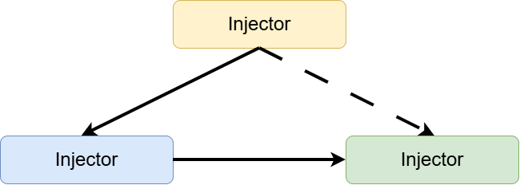

# Dependency Injection Pattern con Ejemplo

Este repositorio es una adaptación del artículo [Dependency Injection Pattern with Examples](https://medium.com/@mohamed.hashish42/dependency-injection-pattern-with-examples-659cc57da03d)

* La clase cliente tiene una dependencia con la clase servicio
* La clase servicio (dependency) provee un servicio a la clase cliente
* La clase Injector inyecta a clase servicio mediante un tipo de dato Interfaz

**IMPORTANTE**: La clase Injector inyecta cualquier clase servicio que implemente la Interfaz

